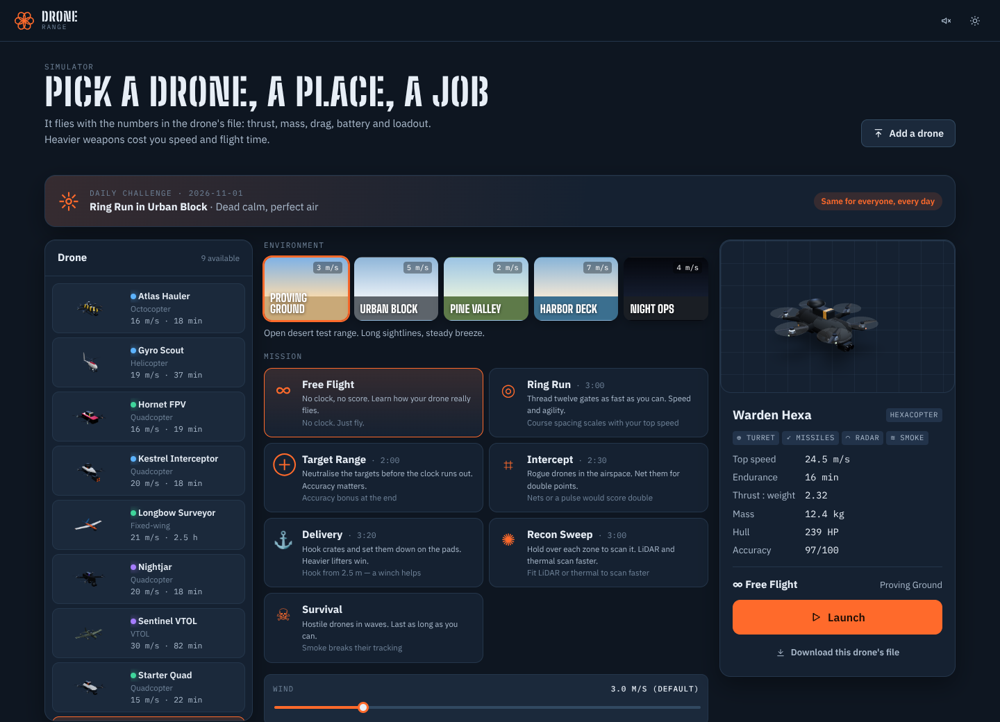
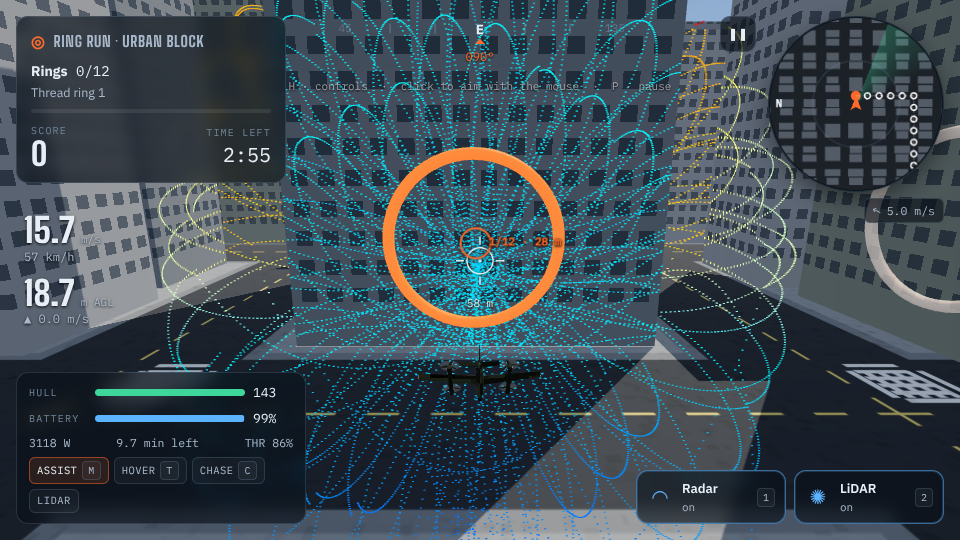
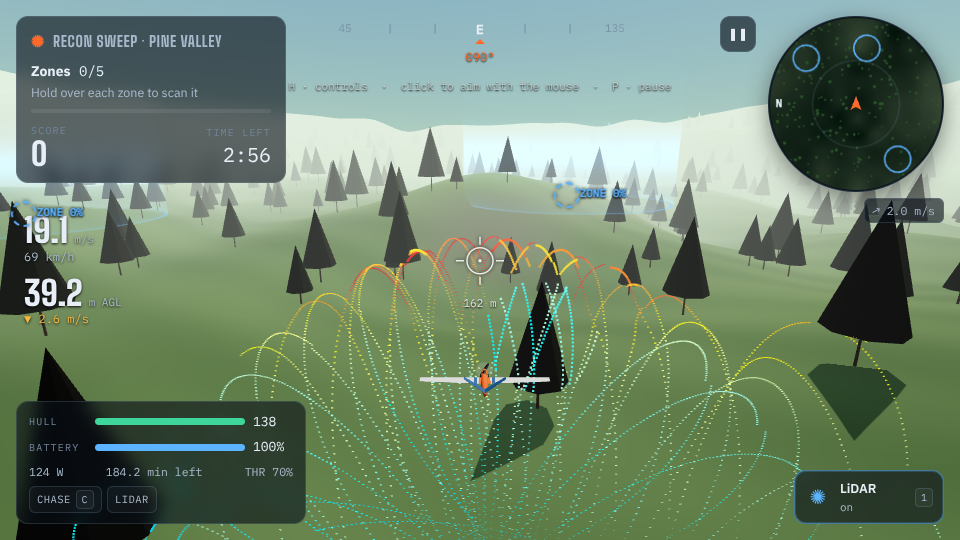
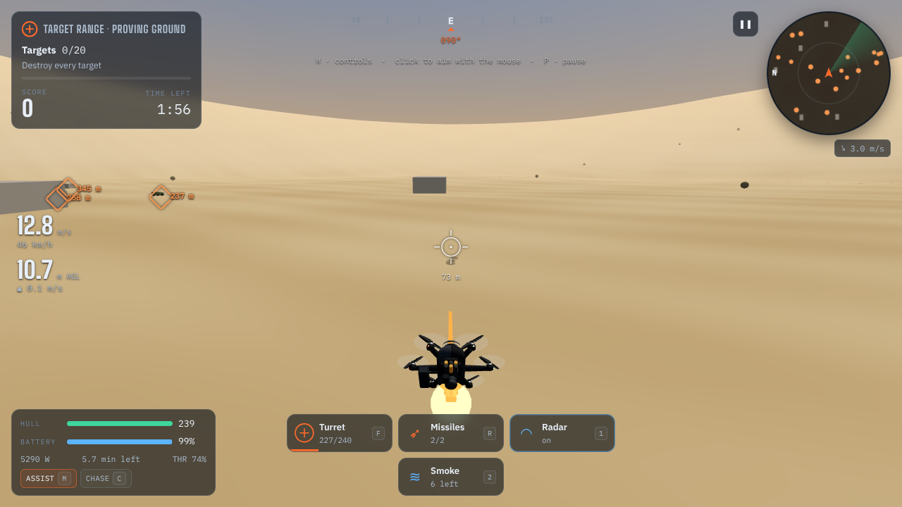
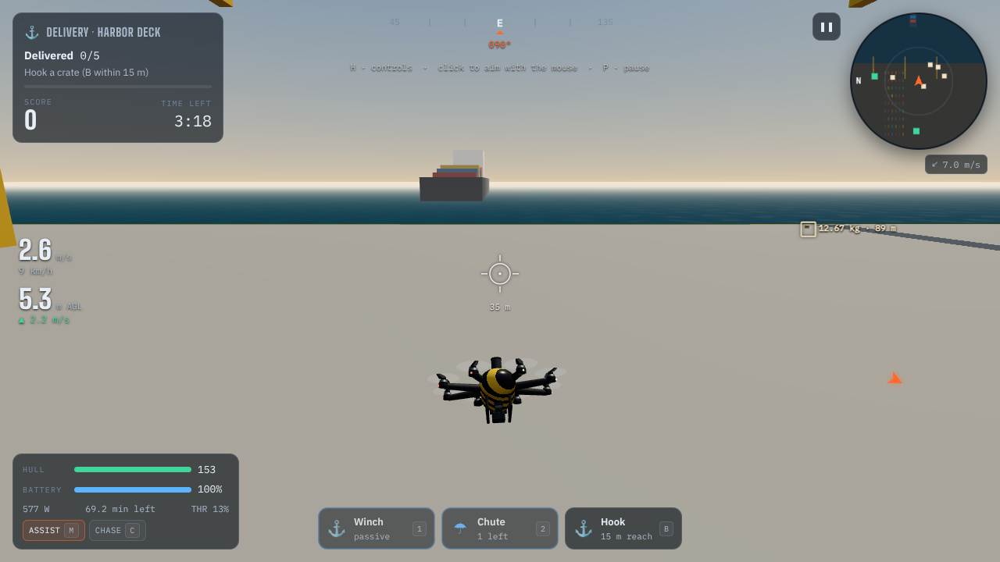

# Drone Range


**Fly it. Shoot it. Fork it.**

[](LICENSE)


[](https://github.com/ChayaNine/drone-range/actions/workflows/ci.yml)


An open-source drone flight and combat simulator that runs in your browser. **Every drone is one small JSON file.** The simulator works out its mass, thrust, drag, battery life and balance from that file, and the flight model and the weapons use those numbers, so a heavier turret really does make a drone slower and shorten its flight.

Pick a drone, a place and a job. Thread rings between towers, shoot targets, net rogue drones, haul cargo with a winch, scan zones with LiDAR, or survive waves of hostiles. Then write your own drone, add your own weapon or mission, or point a bot at it. No account, no server, nothing to install but Node.

| | |
| --- | --- |
| **Missions** | 7: Free Flight, Ring Run, Target Range, Intercept, Delivery, Recon Sweep, Survival, plus a daily challenge that is the same for everyone |
| **Places** | 5: desert range, city blocks, pine valley, harbour, night ops |
| **Drones** | 9 included, from a 1.3 kg starter quad to a 12 kg armed hexacopter and a 150-minute fixed-wing. Add yours with one file |
| **Airframes** | 13: quad (X, +, H), tri, hexa, octo, Y6, X8, VTOL quadplane, fixed-wing, helicopter |
| **Weapons and systems** | 6 weapons and 9 systems (radar, LiDAR, thermal, winch, smoke, ...). All fictional game modules |
| **Controls** | Keyboard and mouse, gamepad, basic touch |
| **Runs on** | Any modern browser with WebGL2. Static files, so any host works |
| **Headless** | The rules run in plain Node with no browser, at several hundred times real time |

- **Live demo:** `<dronesimulate.com>`
- **Built with:** TypeScript, React 19, three.js, React Three Fiber, zustand, Vite, Vitest



## See it fly

| | |
| --- | --- |
|  |  |
| **Ring Run, Urban Block.** LiDAR paints a live point cloud of the street as you thread the gates. | **Recon Sweep, Pine Valley.** A fixed-wing scanning zones. It has to keep moving to stay up. |
|  |  |
| **Target Range.** A turret, two missiles, radar and smoke. Every one of them weighs something. | **Delivery, Harbor Deck.** Hook a crate, carry it (it swings), set it down on the pad. |

*The screenshots were captured on a software renderer in a cloud VM, so shadows are simplified and it looks and runs better on a real GPU.*

## Quick start

You need [Node.js](https://nodejs.org) 20 or newer.

```bash
git clone https://github.com/YOUR-USER/drone-range.git
cd drone-range
npm install
npm run dev
```

Open <http://localhost:5173>, choose a drone, a place and a mission, and press **Launch**. Click in the window to capture the mouse for aiming. Press **H** in flight for the controls.

To try the headless mode straight away:

```bash
npm run example:headless          # a scripted pilot plays Target Range in about a quarter of a second
```

## Controls

| Key | Multirotor, VTOL, helicopter | Aeroplane |
| --- | --- | --- |
| `W` `S` | Forward / back | Nose down / up |
| `A` `D` | Slide left / right | Roll left / right |
| `Q` `E` or `←` `→` | Turn | Rudder |
| `Space` `Shift` | Climb / descend | Throttle up / down |
| Mouse (click to capture) | Look up and down to aim, sideways to turn | same |
| `F` or left click | Weapon 1 | same |
| `R` or right click | Weapon 2 | same |
| `1` `2` | System 1 / 2 (radar, LiDAR, thermal, smoke, ...) | same |
| `B` | Hook or release cargo, drop a pod | same |
| `T` | VTOL: hover ↔ wing | |
| `M` | Assist (velocity) ↔ angle mode | |
| `↑` `↓` | Tilt the gimbal | same |
| `C` | Camera: chase, FPV, orbit | same |
| `N` or click the map | Map zoom | same |
| `P` or `Esc` | Pause | same |
| `Backspace` | Restart | same |
| `H` | Help | same |

Gamepads work too: left stick throttle and yaw, right stick pitch and roll, triggers fire, `A` and `B` toggle systems, `X` is the hook, `Y` changes camera. Touch devices get on-screen sticks and fire buttons.

## Missions

You are scored, then given up to three stars. Finishing early earns a time bonus, and the shooting missions add an accuracy bonus. Scores are kept in your browser; the start screen shows your top five for the mission and place you have selected.

<!-- TABLE:missions -->
| id | Mission | Clock | Stars at | Needs | Goal |
| --- | --- | --- | --- | --- | --- |
| `free` | ∞ Free Flight | none | - | - | No clock, no score. Learn how your drone really flies. |
| `rings` | ◎ Ring Run | 3:00 | 1500 / 2500 / 3000 | - | Thread twelve gates as fast as you can. Speed and agility. |
| `targets` | ⊕ Target Range | 2:00 | 1200 / 2400 / 3600 | turret, bombs, missiles or laser | Neutralise the targets before the clock runs out. Accuracy matters. |
| `intercept` | ⌗ Intercept | 2:30 | 1000 / 2200 / 3400 | any weapon | Rogue drones in the airspace. Net them for double points. |
| `delivery` | ⚓ Delivery | 3:20 | 1200 / 2400 / 3500 | - | Hook crates and set them down on the pads. Heavier lifters win. |
| `recon` | ✺ Recon Sweep | 3:00 | 1200 / 2300 / 3300 | - | Hold over each zone to scan it. LiDAR and thermal scan faster. |
| `survival` | ☠ Survival | none | 1500 / 3500 / 6000 | any weapon | Hostile drones in waves. Last as long as you can. |
<!-- /TABLE:missions -->

The **daily challenge** picks a mission, a place and a twist (a gale, fog, half a battery, dead calm, dusk) from today's date, so everyone gets the same one with no server involved.

### Places

<!-- TABLE:environments -->
| id | Environment | Wind | Notes |
| --- | --- | --- | --- |
| `range` | Proving Ground | 3 m/s | Open desert test range. Long sightlines, steady breeze. |
| `city` | Urban Block | 5 m/s | Streets, towers and gusts that funnel between them. |
| `forest` | Pine Valley | 2 m/s | Rolling hills and tall pines. Fly low if you dare. |
| `harbor` | Harbor Deck | 7 m/s | Container stacks, a cargo ship and open water. |
| `night` | Night Ops | 4 m/s | The city after dark. Lights, thermals and long shadows. |
<!-- /TABLE:environments -->

## Weapons and systems

A drone carries up to **two weapons and two systems**, each on a mount (belly, nose, top, tail, or a pylon on the left or right). Mass, power draw and drag all feed the performance model, so loadout is a real trade-off: a 1.35 kg turret on a small quad can leave it unable to take off, and the start screen will say so.

All of them are **fictional, abstract game modules** with invented stats. They are not models of real weapons, and this project will not accept real-world weapon data.

<!-- TABLE:weaponsBrief -->
| id | Name | Weight · power | Mounts | What it does |
| --- | --- | --- | --- | --- |
| `kinetic` | KN-7 Kinetic Turret | 1.35 kg · 35 W | belly, nose | Rapid single-shot projectiles. Spread grows on light, twitchy airframes. |
| `bomb` | GB-4 Gravity Rack | 1.65 kg · 5 W | belly, left, right | Four unpowered drop payloads. Lead your release: they keep your speed. |
| `net` | NL-3 Net Launcher | 0.85 kg · 6 W | nose, belly | Captures drones intact. Short range, generous spread. |
| `missile` | MH-2 Micro-Missile Pod | 1.1 kg · 12 W | left, right, belly | Two homing rounds. Hold a target in the reticle to lock. |
| `laser` | LD-1 Laser Designator | 0.32 kg · 18 W | nose, belly | Paints targets: painted targets score double and show through walls. |
| `emp` | EP-9 Pulse Emitter | 1.4 kg · 220 W | top, belly | Disables every drone in a bubble. Long recharge, big power draw. |
<!-- /TABLE:weaponsBrief -->

<!-- TABLE:systemsBrief -->
| id | Name | Weight · power | Mounts | What it does |
| --- | --- | --- | --- | --- |
| `radar` | RX-1 Compact Radar | 0.7 kg · 45 W | top, nose | Shows every target within range on the minimap, through terrain. |
| `lidar` | Livox Avia LiDAR | 0.498 kg · 8 W | nose, belly | Live non-repetitive point cloud in flight. Datasheet mass and power. |
| `thermal` | TH-640 Thermal Camera | 0.23 kg · 4 W | nose, belly | Heat vision. Engines and motors glow through night and smoke. |
| `carrier` | CB-3 Carrier Bay | 1.9 kg · 15 W | belly | Launches three micro-drones that scout and harass targets. |
| `searchlight` | SL-20 Searchlight | 0.42 kg · 60 W | nose, belly | 20,000 lumen steerable light. Essential after dark. |
| `smoke` | SD-6 Smoke Dispenser | 0.55 kg · 2 W | tail, belly | Six canisters. Breaks missile locks and hides you from sentries. |
| `winch` | WH-15 Cargo Winch | 0.95 kg · 30 W | belly | Hook, lift and deliver crates. The load swings — fly smooth. |
| `stealth` | RAM Stealth Skin | scales · none | top | Radar-absorbing, low-reflectivity coat. Cuts RCS and LiDAR returns. |
| `parachute` | PR-2 Recovery Chute | scales · none | top | Saves the airframe once: a crash becomes a soft landing. |
<!-- /TABLE:systemsBrief -->

The LiDAR uses the published weight and power of a real sensor (a Livox Avia: 498 g, 8 W), because that is the kind of detail that makes loadout trade-offs honest. The points it draws are simulated.

## Add your own drone

Three ways, no code:

1. **Drop a file** into [`src/drones/`](src/drones) named `something.drone.json`. It shows up in the picker.
2. **Drag it onto the start screen**, or press **Add a drone** and paste JSON. It is saved in your browser only.
3. **Generate one** with the command line:

```bash
npm run drone:new -- --name "Picket" --layout quad_x --length 0.9 --weapon kinetic --system radar
npm run drone:check              # prints mass, speed, endurance and thrust:weight for every drone
```

A drone can be as short as this:

```json
{
  "name": "Starter Quad",
  "layout": "quad_x",
  "length": 0.45
}
```

or as detailed as you like: weapons and systems with their mounts, avionics grade, frame and propeller materials, battery chemistry, body shape and paint. Anything you leave out is chosen for you. **Motors and battery are sized to suit the airframe and the loadout you picked**, so you describe what the drone *is* and the simulator works out whether it can fly.

If a file has a mistake, the loader lists every problem, with the field name and the allowed values:

![The Add a drone dialog rejecting a file: weapons[1] "railgun" is not known. Choose one of: kinetic, bomb, net, missile, laser, emp.](docs/img/add-drone-error.png)

Drone files exported from **Drone Surrogate Factory** (the designer this simulator came from) load unchanged. The full field reference, with every allowed value, is in [`docs/DRONE_FORMAT.md`](docs/DRONE_FORMAT.md).

Made a good one? Open a pull request with the file. See [CONTRIBUTING.md](CONTRIBUTING.md).

## Build on it

Everything the simulator does is in plain TypeScript, and the rules do not touch the browser.

| You want to | Start here |
| --- | --- |
| Add a weapon, system, mission or environment | [`docs/EXTENDING.md`](docs/EXTENDING.md): the files to touch, in order, with a test for each |
| Understand how it fits together | [`docs/ARCHITECTURE.md`](docs/ARCHITECTURE.md): data flow, the fixed 120 Hz loop, coordinate frames, determinism |
| Write a drone file | [`docs/DRONE_FORMAT.md`](docs/DRONE_FORMAT.md) |
| Run it from a script, a bot or a test | [`examples/headless.ts`](examples/headless.ts) |
| Rebrand or fork it | [`src/config.ts`](src/config.ts): name, tagline, repo link, storage prefix |

The headless example is short enough to read in a minute. It builds a `Game` from a drone file, steps it, and prints the result:

```text
$ npm run example:headless
Warden Hexa · Target Range · Proving Ground
  ended:    complete after 88.4 s of game time (251 ms of CPU, 353x real time)
  score:    2491  (2 stars)
  shooting: 76 hits / 225 shots, 20 destroyed
```

(The speed is from a cloud VM and will vary. The score is what that scripted pilot gets, so you can beat it.)

Ideas that would be welcome are at the bottom of [`docs/EXTENDING.md`](docs/EXTENDING.md): replays, a mission editor, evasive enemies, a reinforcement-learning harness, online leaderboards.

## Project layout

```text
src/
  drones/       the bundled drone files (*.drone.json): drop one in and it appears
  engine/       what a drone is: layouts, parts catalogue, performance model, 3D geometry
  sim/          what happens when it flies
    game.ts       missions, weapons, systems, scoring (no rendering: runs headless)
    flight.ts     flight physics for multirotor, aeroplane, VTOL, helicopter
    world.ts      the five environments
    catalog.ts    mission and environment definitions, the daily challenge
    Scene.tsx, Hud.tsx, input.ts, audio.ts    drawing, HUD, controls, sound
  lib/          loading drone files, the drone library, local scores
  pages/        the start screen and the flight screen
  components/   shared UI and the 3D drone viewer
scripts/        drone:new, drone:check, docs:tables
examples/       headless.ts
tests/          headless tests: drone files, performance model, physics, missions
docs/           format, extending and architecture guides, screenshots
```

## Deploy

It is a static site. `npm run build` writes `dist/`, which you can put on any static host: GitHub Pages, Netlify, Vercel, Cloudflare Pages, an S3 bucket, or a folder on your own server. Routing is hash-based and asset paths are relative, so it works from a sub-folder with no server rewrite rules.

```bash
npm run build           # dist/: the normal multi-file site
npm run build:single    # dist-single/index.html: one self-contained file you can email or open from disk
npm run preview         # serve dist/ locally
```

## Scripts

| Command | What it does |
| --- | --- |
| `npm run dev` | Dev server with hot reload |
| `npm run build` | Type-check, then build to `dist/` |
| `npm run build:single` | One self-contained `dist-single/index.html` |
| `npm run preview` | Serve the production build locally |
| `npm run typecheck` | TypeScript, strict |
| `npm test` | Headless tests: drone loading, the performance model, physics and missions |
| `npm run drone:new` | Write a new drone file from options |
| `npm run drone:check` | Check every drone file loads and can fly; exits non-zero if not |
| `npm run docs:tables -- --write` | Refresh the generated tables in the docs from the code (`--check` in CI) |
| `npm run example:headless` | Fly a mission with no browser |

## Honest limits

- **Estimates, not engineering.** The performance model (mass, thrust, speed, endurance) and the flight physics are plausible and consistent, and built from real-world quantities, but they are a game model. They are not validated against real aircraft, and nothing here should be used to design or operate one.
- **Scores are local.** They live in your browser. There are no accounts, online leaderboards or multiplayer. (The daily challenge is the same for everyone, but nothing compares your result with anyone else's.)
- **Fixed layouts.** A mission in a place starts with the same layout every time, which keeps scores comparable. Random layouts are a small change if you want them (see [`docs/ARCHITECTURE.md`](docs/ARCHITECTURE.md)).
- **No custom 3D models here.** A drone from the factory designer that uses an imported mesh still loads, but it is drawn with its generic airframe.
- **Needs WebGL2.** There is no friendly fallback screen if a browser lacks it.
- **Performance depends on your GPU.** There is a quality setting in flight (shadows and resolution). On software rendering it is a slideshow.
- **Touch controls are basic.** Keyboard and mouse or a gamepad is the intended way to play.
- **Not tested on every browser or OS.** It was developed and its screenshots taken in Chromium. Reports from Firefox, Safari and mobile are welcome.
- **The CI workflow has not yet run on GitHub.** `.github/workflows/ci.yml` runs the same commands listed above, which pass locally.

## Contributing

Pull requests are welcome, and the easiest one is a new drone file. Read [CONTRIBUTING.md](CONTRIBUTING.md) first; it is short.

## License

[MIT](LICENSE). Use it, change it, ship it.

## Credits

- [three.js](https://threejs.org), [React Three Fiber](https://github.com/pmndrs/react-three-fiber) and [drei](https://github.com/pmndrs/drei) for the 3D.
- [zustand](https://github.com/pmndrs/zustand), [React](https://react.dev), [Vite](https://vite.dev) and [Vitest](https://vitest.dev).
- Fonts through [Fontsource](https://fontsource.org): Big Shoulders Display, Big Shoulders Stencil Display, IBM Plex Sans and IBM Plex Mono.
- LiDAR weight and power are the published figures for the Livox Avia.
