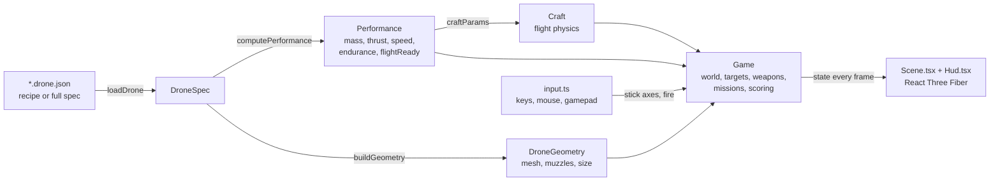

# Architecture

How a JSON file becomes a drone you can fly, and where each piece of the code lives. Read this before changing anything in `src/engine/` or `src/sim/`.

## The idea

**The drone's file is the only source of truth.** Mass, thrust, drag, battery life and balance are computed from the file, and the flight model and the weapons read those numbers. Nothing in the simulator knows the name of a drone. That is why adding a heavy turret makes a drone slower and shortens its flight, and why a new file needs no new code.



| Step | Where | What it does |
| --- | --- | --- |
| Load | [`src/lib/spec.ts`](../src/lib/spec.ts) | Validates a file (recipe or full spec), fills in defaults, sizes motors and battery for a recipe. Throws `SpecError` with every problem listed. |
| Describe | [`src/engine/performance.ts`](../src/engine/performance.ts) | `computePerformance(spec)`: mass breakdown, thrust-to-weight, top speed, endurance, balance, the pass/fail checks behind "flight-ready", and the numbers the flight model needs. |
| Shape | [`src/engine/geometry.ts`](../src/engine/geometry.ts) | `buildGeometry(spec)`: the 3D model, its size, and where each weapon's muzzle is. |
| Fly | [`src/sim/flight.ts`](../src/sim/flight.ts) | `Craft`: the physics of a multirotor, aeroplane, VTOL or helicopter, from `craftParams(perf, size)`. |
| Play | [`src/sim/game.ts`](../src/sim/game.ts) | `Game`: wraps a `Craft` and adds the world, targets and enemies, weapons, systems, missions and scoring. |
| Show | [`src/sim/Scene.tsx`](../src/sim/Scene.tsx), [`Hud.tsx`](../src/sim/Hud.tsx) | Draw whatever `Game` holds. They never change the rules. |

## Folders

| Folder | What lives there | Needs a browser? |
| --- | --- | --- |
| `src/engine/` | Layouts, parts catalogue, performance model, geometry, battery and motor maths | No |
| `src/sim/` (`game`, `flight`, `world`, `catalog`) | The rules and physics | No |
| `src/sim/` (`Scene`, `Hud`, `audio`, `input`) | Rendering, HUD, synthesised sound, keyboard/mouse/gamepad | Yes |
| `src/lib/` | Drone file loading, the drone library, local scores, localStorage helpers | `storage` and `scores` use `localStorage` and fall back to memory without it |
| `src/pages/` | `Home` (the picker) and `Flight` (the run and its results) | Yes |
| `src/components/` | Shared UI and the 3D drone viewer | Yes |
| `src/drones/` | Bundled drone files, picked up automatically | |
| `scripts/`, `examples/` | Command-line tools and the headless example | |
| `tests/` | Vitest suites | |

The split is on purpose: **`engine/` and the rules in `sim/` import nothing from React or the DOM**, so the game can be stepped from a test, a script or a server. Rendering is a thin layer on top.

## The loop

`SimLoop` in [`src/pages/Flight.tsx`](../src/pages/Flight.tsx) runs inside React Three Fiber's frame callback:

1. Read the player's input (`input.ts` turns keys, mouse and gamepad into the same four stick axes plus two fire buttons).
2. Add the real elapsed time to an accumulator, capped at 0.1 s so a stalled tab does not fast-forward.
3. While the accumulator holds at least one step (**1/120 s**), call `game.update(STEP, input, fire)`. At most 14 steps per frame, so a slow machine slows the game down rather than spiralling.
4. Draw. The 3D scene reads `game` directly every frame.
5. About ten times a second, copy a small snapshot of the game into React state for the HUD, so React is not re-rendering at 60 Hz.

A fixed step means the physics does not change with frame rate or with how fast the machine is.

## Coordinates

Two frames are in use, and the seam is easy to trip over.

| Frame | Axes | Used by |
| --- | --- | --- |
| **World** (three.js) | Y up, +x east, +z south | `Game`, `Craft`, `world.ts`, `Scene.tsx` |
| **Body** | +X forward, +Y up, +Z right | the craft's own orientation |
| **Model** (engine) | Z up, +X forward, +Y left | `geometry.ts`, muzzle positions, `Mount` points |

`zUpToBody(p)` in `game.ts` converts a model-frame point (such as a muzzle) to the body frame. `DroneModel.tsx` applies the matching rotation when it draws the mesh. If a new module's barrel points the wrong way, this is the first place to look.

## Determinism

Everything that affects the rules is driven by a seeded generator (`mulberry32`). The only `Math.random()` calls are in visuals (the night-sky star positions, the speckle on the ground texture), audio noise, and generating IDs for saved drones.

The world and each mission's layout depend on the seed, the environment and the mission, and the seed is fixed today (7, or `7 + len(date key)` for the daily challenge). So **every run of a mission in an environment starts with the same layout**, which is what makes local scores comparable. (Things that happen later, like where a Survival wave appears, depend on how you play, because shot spread and spawns draw from the same generator.) Passing a different `seed` to `new Game(...)` gives a different layout; wiring that to a "random layout" switch is a small, welcome change.

Given the same seed and the same inputs, a run replays exactly. That makes replays and automated regression tests possible.

## Running the rules without a browser

```ts
import { readFileSync } from 'node:fs'
import { loadDrone } from './src/lib/spec'
import { computePerformance } from './src/engine/performance'
import { buildGeometry } from './src/engine/geometry'
import { Game } from './src/sim/game'
import { envById, missionById } from './src/sim/catalog'

const { spec } = loadDrone(readFileSync('src/drones/warden-hexa.drone.json', 'utf8'))
const game = new Game({
  spec, perf: computePerformance(spec), geo: buildGeometry(spec),
  env: envById('range'), mission: missionById('targets'), seed: 7,
})
game.countdown = 0                       // skip the 3-2-1

for (let i = 0; i < 120 * 60 && !game.over; i++) {
  game.update(1 / 120, { pitch: 0, roll: 0, yaw: 0, throttle: 0 }, [false, false])
}
console.log(game.craft.pos, game.objective(), game.score)
```

[`examples/headless.ts`](../examples/headless.ts) is a complete, runnable version with a simple pilot (`npm run example:headless`). On the machine it was written on it plays a full 90-second Target Range in about a quarter of a second. Your numbers will differ, but expect hundreds of times real time.

Two things to know:

- `loadBundled()` in `library.ts` uses Vite's `import.meta.glob`, so it only works under Vite or Vitest. In a plain Node script, read the file and call `loadDrone` as above.
- In the browser the camera supplies the aim ray (`game.setAim(origin, direction)`). Headless, call it yourself each step, or the weapons fire along the default aim.

## What the flight model is (and is not)

`Craft` is a game-grade model with real inputs: the aircraft's actual mass, its thrust from the motors and propellers, drag from its frontal area and loadout, and battery energy drawn at the power it is using. Multirotors have assisted and angle modes; aeroplanes have lift, stall and a throttle; VTOLs transition between the two; helicopters have a single rotor.

It is **not** a validated aerodynamic simulation. Treat the numbers as plausible and consistent, not as engineering predictions. The performance model that feeds it says the same: its figures are estimates.

## Storage

Everything the app saves is in the browser's `localStorage`, under keys that start with `range.` (change `STORAGE_PREFIX` in [`src/config.ts`](../src/config.ts) when you rebrand, so forks do not read each other's data on the same origin; the one exception is the early theme script in `index.html`, which has the key written out, so change it there too).

| Key | Holds |
| --- | --- |
| `range.drones` | Drones you added in the browser |
| `range.runs` | Your best runs, top 8 per mission and environment |
| `range.theme`, `range.mute` | Light/dark choice, sound on/off |
| `range.simq`, `range.simHelpSeen` | Graphics quality, whether the controls card has been shown |

If `localStorage` is unavailable (private windows, blocked cookies) the app still works and simply does not remember anything.

## Tests

`npm test` runs three suites under Vitest, headless:

| Suite | Checks |
| --- | --- |
| `tests/drones.test.ts` | Recipes and specs load, bad files are rejected with a useful message, a file exported by Drone Surrogate Factory loads unchanged, every bundled drone loads without warnings |
| `tests/performance.test.ts` | Every bundled drone is flight-ready, a heavy weapon costs mass and endurance, the model is centred and matches its envelope, the two-weapons-two-systems cap holds, every module has mass, mounts and a description |
| `tests/sim.test.ts` | A multirotor reaches its published top speed, an aeroplane holds altitude, the battery drains, buildings hurt, ring courses never pass through a building in any environment, a turret destroys a target, a net captures a rogue drone, worlds are deterministic |

`npm run drone:check` and `npm run docs:tables -- --check` are not tests, but CI runs them too.
